<!-- brief:start -->

<picture><source media="(prefers-reduced-motion: reduce)" srcset="./assets/header.static.svg"></picture>
<a href="https://hooli.sh/archive/">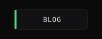</a>
<picture><source media="(prefers-reduced-motion: reduce)" srcset="./assets/situation.static.svg"></picture>
<picture><source media="(prefers-reduced-motion: reduce)" srcset="./assets/city.static.svg"></picture>
<a href="https://github.com/exarvo/dotfiles"></a><a href="https://github.com/exarvo/rag-ado-wiki"></a>
<a href="https://github.com/exarvo/teams-chat-bot">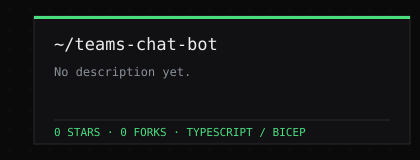</a><a href="https://github.com/exarvo/node-cli">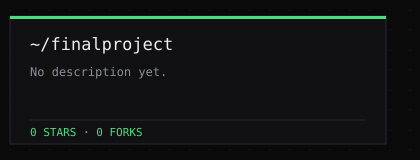</a>
<a href="https://github.com/exarvo/node-api"></a><a href="https://hooli.sh/projects/"></a>
<picture><source media="(prefers-reduced-motion: reduce)" srcset="./assets/stack.static.svg"></picture>

<a href="https://hooli.sh/archive/docker-advanced/"></a><a href="https://hooli.sh/archive/docker-concepts/"></a>
<a href="https://hooli.sh/archive/github-actions-trick/">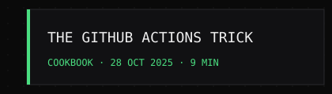</a><a href="https://hooli.sh/archive/"></a>

<!-- brief:end -->
